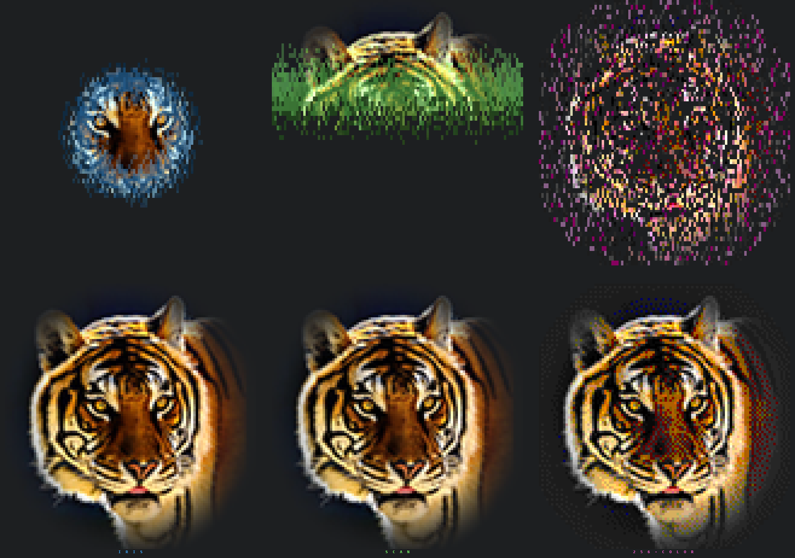

<div align="center">


# terminal-tiger

**Photographic, animated portraits for your terminal.**
Give your CLI some style: a tiger (or your dog, your logo, your face) that
reveals itself every time you open a shell.

*Built at Google for Startups · Los Angeles Tech Week 2026*

[Live playground](https://joshogden360.github.io/terminal-tiger/) · [Quick start](#quick-start) · [Make it yours](#make-it-yours) · [How it works](#how-it-works) · [Credits](#credits)

</div>

> **Live playground:** [`docs/index.html`](docs/index.html) replays the reveal in your
> browser and writes the matching command as you pick a reveal style, accent and
> title. To publish it, turn on GitHub Pages (Settings → Pages → Deploy from a
> branch → `main` / `docs`).

---

## Quick start

Zero install, one line (needs [uv](https://docs.astral.sh/uv/)):

```sh
uv run https://raw.githubusercontent.com/joshogden360/terminal-tiger/main/terminal_tiger.py
```

The first run downloads the tiger photo into `~/.cache/terminal-tiger/`. After
that it works offline.

Install it as a command:

```sh
uv tool install git+https://github.com/joshogden360/terminal-tiger
# or: pipx install git+https://github.com/joshogden360/terminal-tiger

terminal-tiger          # also available as: tiger
```

Greet yourself once a day when a new shell opens:

```sh
terminal-tiger --install-shell zsh     # or bash, fish
```

This adds a small, clearly marked block to your rc file. It runs with
`--once-a-day`, so it never slows down the shells you open after that. To
remove it, delete the block between the `terminal-tiger` markers.

## Make it yours

Any photo works. Front-facing, evenly lit, on a plain or dark background works best.

```sh
terminal-tiger ~/Pictures/cookie.jpg --title cookie
terminal-tiger https://example.com/logo.png --reveal iris --accent "#3fa9ff"
```

| Flag | What it does | Default |
| --- | --- | --- |
| `--crop L T R B` | Crop box, as fractions of the image | `0 0 1 1` |
| `--eyes X,Y X,Y` | Eye positions (fractions of the *cropped* image). The ripple starts here. | none |
| `--title TEXT` | Letter-spaced title, typed out after the reveal | `tiger` (tiger preset) |
| `--subtitle TEXT` | Dim line below. Tokens: `{user} {host} {date} {time} {cwd}` | none |
| `--accent #hex` | Color of the reveal flash and the title | `#ff8c1e` |
| `--title-color #hex` | Title color, if different from the accent | accent |
| `--bg #hex` | Your terminal background, so the vignette fades into it | `#202124` |
| `--reveal STYLE` | `ripple` · `iris` · `scan` · `dissolve` · `none` | `ripple` |
| `--duration SEC` | How long the wave takes to cross the image | `1.6` |
| `--vignette N` | Edge softness, `0` = off | `1.4` |
| `--saturation` `--contrast` `--sharpen` | Photo tuning | `1.15` `1` `1` |
| `--width` `--max-height` | Size in terminal cells | fit the terminal |
| `--mode` | `auto` · `true` (24-bit) · `direct` (old tmux) · `256` | `auto` |
| `--no-anim` | Draw instantly | |
| `--once-a-day` | Show at most once per day (for shell startup) | |

> **Finding the eyes:** open the image in any editor and read the pixel
> coordinates of each pupil. Subtract the crop's left/top edge, then divide by
> the crop's width/height. Or just guess, run it, and nudge. It takes about a minute.

### Presets & config

Save your look in `~/.config/terminal-tiger/config.toml` (see
[`examples/config.toml`](examples/config.toml)):

```toml
preset = "cookie"            # what `terminal-tiger` shows with no arguments

[style]                      # applies to every preset
bg = "#1d1f21"
subtitle = "welcome back, {user}"

[presets.cookie]
image = "~/Pictures/cookie.jpg"
crop = [0.10, 0.00, 0.90, 0.85]
eyes = [[0.40, 0.42], [0.60, 0.42]]
title = "cookie"
accent = "#ffd166"
```

Settings are applied in this order, each overriding the last: built-in
defaults → built-in preset → `[style]` → `[presets.NAME]` → command-line flags.
Run `terminal-tiger --list` to see your presets.

## Showcase



*Top row: mid-reveal. Bottom row: finished. Left to right: `--reveal iris --accent "#3fa9ff"`, `--reveal scan --accent "#7cff6b"`, `--mode 256 --reveal dissolve --accent "#ff4fd8"`.*

Made something great? Open a PR that adds it here.

## How it works

The project started as a plain ASCII tiger that looked like static. These are
the changes that turned it into a portrait, roughly in order of impact:

1. **Half-block pixels.** Each character cell prints `▀` with a 24-bit
   *foreground* color (the top pixel) and a 24-bit *background* color (the
   bottom pixel). That gives two square-ish pixels per cell, full color, and
   no aspect-ratio squash. Brightness-ramp ASCII throws all that color away.
2. **Pick the right photo.** A dark background, a front-facing pose and both
   ears in frame mattered more than any code change.
3. **Contrast without changing the colors.** Plain `autocontrast` stretches the R, G
   and B channels separately, which turned brown fur red. `preserve_tone=True`
   stretches brightness only.
4. **A vignette** fades the edges into your terminal background, so the
   portrait floats instead of sitting in a rectangle.
5. **The tmux trap.** Google Cloud Shell runs inside **tmux 2.1**, which
   silently converts 24-bit color to 256 colors (truecolor passthrough arrived
   in tmux 2.2). `--mode direct` detects this and writes straight to the
   client's tty with `tmux display -p '#{client_tty}'`, skipping tmux entirely.
6. **A 256-color fallback that still looks good.** For terminals without
   truecolor, the image is Floyd–Steinberg dithered into the xterm-256
   palette with perceptual weights, so browns don't collapse into maroon.
7. **The reveal.** Every cell gets a start time from its distance to the eyes,
   plus a little noise, so the edge looks organic instead of a perfect circle.
   It fades up from black through a flash of the accent color. Only cells that
   change are redrawn, at roughly 30 fps. Cells are positioned with save/restore cursor and
   relative moves, so it draws *inline* under your prompt without clearing
   the screen.

### Terminal support

| Terminal | Mode picked by `auto` |
| --- | --- |
| iTerm2, WezTerm, Kitty, Alacritty, Ghostty, Windows Terminal, VS Code, GNOME Terminal | `true` |
| tmux ≥ 2.2 with `set -as terminal-features ',*:RGB'` | `true` |
| tmux ≥ 2.2 without RGB enabled | `256` (add the line above to `~/.tmux.conf` for full color) |
| tmux < 2.2 (e.g. Google Cloud Shell) | `direct` |
| Apple Terminal, Linux console | `256` |

Output that is piped or redirected gets static lines with no cursor movement,
so `terminal-tiger > tiger.ans && cat tiger.ans` works.

## Record your own demo

`tools/make_demo.py` runs the real CLI inside a virtual terminal (a pty plus
[pyte](https://github.com/selectel/pyte)) and turns the byte stream into a
GIF. No screen recorder is needed, and it works headless:

```sh
uv run tools/make_demo.py docs/mine.gif --bg "#1d1f21" -- ~/me.jpg --title me --bg "#1d1f21"
```

## Development

```sh
uv run pytest            # tests: config precedence, dithering, reveal timing, rendering
```

The CLI is a single, dependency-light file
([`terminal_tiger.py`](terminal_tiger.py)) with inline
[PEP 723](https://peps.python.org/pep-0723/) metadata, and its source is
**ASCII-only** on purpose, so it can be pasted or typed into any terminal, even
through a browser. See [CONTRIBUTING.md](CONTRIBUTING.md).

## Credits

- Built at **Google for Startups · Los Angeles Tech Week 2026** by
  [Josh Ogden](https://github.com/joshogden360).
- Default photo: [“Bengal Tiger Portrait”](https://commons.wikimedia.org/wiki/File:Bengal_Tiger_Portrait.jpg)
  by **Shootsalot**, licensed [CC BY-SA 4.0](https://creativecommons.org/licenses/by-sa/4.0/),
  via Wikimedia Commons. The photo is **not** included in this repository. It is
  downloaded on first run.
- `docs/demo.gif`, `docs/demo.png`, `docs/styles.png` and the cell data
  embedded in `docs/index.html` are renderings of that photo, and are shared
  under CC BY-SA 4.0. See [CREDITS.md](CREDITS.md).
- Code: [MIT](LICENSE).
